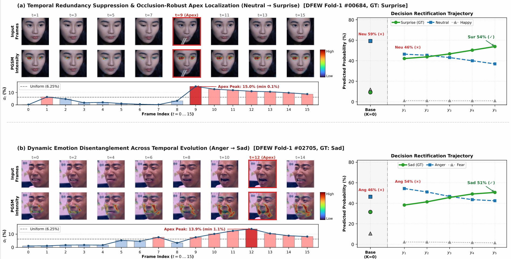

<div align="center">


# IOR-Net: Iterative Orthogonal Refinement Network with Prototype Saliency for Dynamic Facial Expression Recognition

**Kai Zhang, Bing An, and Xinke Li\***

*College of Artificial Intelligence Medicine, Chongqing Medical University*

[](https://pytorch.org/)
[](https://developer.nvidia.com/cuda-toolkit)
[](https://www.python.org/)
[](https://huggingface.co/kz801/IOR-Net)
[](LICENSE)

</div>

Official PyTorch implementation of **IOR-Net** (*Iterative Orthogonal Refinement Network with Prototype Saliency*) for Dynamic Facial Expression Recognition (DFER) in unconstrained scenarios.

---

## Overview

Dynamic facial expressions in the wild are often transient, low-intensity, and degraded by pose variations, occlusions, background clutter, and neutral transition frames. Departing from conventional static feed-forward inference, **IOR-Net** formulates video expression recognition as progressive state-space estimation atop a Kinetics-400 pre-trained Vision Transformer video backbone (`InternVideo2-S/14`) through three coordinated components:

- **Iterative Feedback Mechanism (IFM):** Establishes a weight-tied closed-loop recurrent inference trajectory across $K$ steps (interleaved with $K-1$ state updates) with Euclidean momentum integration ($\beta = 0.9$, $V_{S,0} = 0$) over the cognitive state $\mathcal{S}_k = \{M_k^{\text{loc}}, M_k^{\text{glo}}, H_k^{\text{loc}}, H_k^{\text{glo}}\}$ to revisit video representations and recursively rectify early misalignments.
- **Orthogonal Decomposition Update Module (ODUM):** Uses learnable class prototypes $W \in \mathbb{R}^{C \times D}$ initialized as a row-orthonormal tight frame (orthogonal Equiangular Tight Frame, O-ETF, $W_0 W_0^\top = I_C$). At each step, ODUM performs exact class-wise orthogonal projection $P_k^s = \mathrm{Diag}(\mathrm{diag}(H_k^s \hat{W}^\top))\hat{W}$ and extracts the orthogonal residual $R_k^s = H_k^s - P_k^s \in \mathrm{span}(\hat{w}_c)^\perp$, structurally enforcing $\langle p_{k,c}^s, r_{k,c}^s \rangle = 0$ ($\max|\cos(P, R)| \le 3.59 \times 10^{-8}$) and confining refinement exclusively to $R_k^s$ to mitigate cross-class interference and feature collapse.
- **Prototype-Guided Saliency Module (PGSM):** Evaluates token-to-prototype maximum alignment across $L$ stacked inverted cross-attention layers with sharpened Softmax temperature $\epsilon = 0.1$, amplifying expressive apices while suppressing non-informative neutral tokens and background clutter during feedback memory updates.

<p align="center">
  
</p>
<p align="center">
  <em><strong>Figure 1.</strong> Overview of the Iterative Orthogonal Refinement Network (IOR-Net), operating across four progressive stages: video tokenization, state initialization, $K$-step iterative orthogonal refinement with prototype-guided saliency filtering, and scaled cosine prototype alignment.</em>
</p>


---

## Key Results

All models are trained end-to-end from Kinetics-400 pre-trained `InternVideo2-S/14` ($T=16$, $224 \times 224$, $D=384$, 12 layers, 6 heads) under a unified protocol: 50 epochs, batch size 8, AdamW (weight decay $0.05$), cosine learning-rate decay ($1 \times 10^{-5}$ backbone, $1 \times 10^{-4}$ new modules), Cross-Entropy loss with label smoothing $0.1$, $\tilde{\tau}_0 = \ln(30.0)$, $\epsilon = 0.1$, and $\beta = 0.9$. Architectural hyperparameters $(K^*, L^*)$ are determined on a leakage-free $10\%$ stratified inner-validation split without accessing test folds. Standard deviations follow Bessel-corrected sample std (`ddof=1`).

### 1. Benchmark Performance, Multi-Seed Stability & Hardware Efficiency

| Benchmark   | Protocol                   | Config $(K, L)$ | Params / FLOPs  |      Throughput (FP16)      |   Seed 42 UAR (%)    |   Seed 42 WAR (%)    |      3-Seed Mean UAR / WAR (%)      |
| :---------- | :------------------------- | :-------------: | :-------------: | :-------------------------: | :------------------: | :------------------: | :---------------------------------: |
| **DFEW**    | 5-Fold CV (7 classes)      |    $(5, 1)$     | 38.00M / 63.10G | 224.6 clips/s (3,593.8 FPS) | **$63.72 \pm 1.58$** | **$74.18 \pm 1.51$** | $63.84 \pm 0.12$ / $73.91 \pm 0.26$ |
| **FERV39k** | Official Split (7 classes) |    $(6, 1)$     | 38.00M / 70.77G | 212.4 clips/s (3,397.8 FPS) |     **$43.09$**      |     **$53.35$**      | $43.23 \pm 0.13$ / $53.06 \pm 0.26$ |
| **MAFW-11** | 5-Fold CV (11 classes)     |    $(4, 1)$     | 38.01M / 55.58G | 237.2 clips/s (3,795.0 FPS) | **$42.21 \pm 3.73$** | **$55.70 \pm 4.55$** | $41.95 \pm 0.27$ / $55.36 \pm 0.30$ |
| **MAFW-43** | 5-Fold CV (43 compound)    |    $(4, 1)$     | 38.14M / 56.79G | 234.8 clips/s (3,757.4 FPS) | **$14.54 \pm 2.08$** | **$37.40 \pm 3.43$** |                  —                  |

- Relative to the identical-backbone static Baseline (`InternVideo2-S/14` + linear head), IOR-Net improves UAR/WAR by $+12.16\% / +9.32\%$ on DFEW ($p_t = 1.46 \times 10^{-4}$), $+9.76\% / +7.94\%$ on FERV39k (McNemar $p = 1.64 \times 10^{-42}$; 3-seed paired $t$-test $p = 2.43 \times 10^{-4}$), and $+9.13\% / +8.26\%$ on MAFW-11 ($p_t = 7.74 \times 10^{-4}$).
- Multi-seed stability is evaluated across three independent seeds $\{42, 100, 2026\}$ with tightly bounded across-seed variance ($\pm 0.12\%\text{--}0.27\%$ UAR and $\pm 0.26\%\text{--}0.30\%$ WAR).

### 2. Step-wise Iterative Error Rectification & Geometric Diagnostics ($y_0 \to \hat{y}_1 \to \hat{y}_K$)

Inspecting intermediate readouts from a single trained checkpoint without auxiliary heads demonstrates statistically significant net-positive clip rectification, monotonic predictive entropy decay, and machine-precision ODUM orthogonality across all four benchmarks:

| Benchmark            | Clips ($N$) | $y_0 \to \hat{y}_1 \to \hat{y}_K$ UAR (%) | $\hat{y}_1 \to \hat{y}_K$ WAR (%) | $\Delta\text{WAR}$ (%) |    +Corr / -Err (Ratio)    |   Exact McNemar $p$    |   $\max\|\cos(P, R)\|$    | $H(\hat{y}_1 \to \hat{y}_K)$ | Mean Flip (%) |
| :------------------- | :---------: | :---------------------------------------: | :-------------------------------: | :--------------------: | :------------------------: | :--------------------: | :-----------------------: | :--------------------------: | :-----------: |
| **DFEW** $(5, 1)$    |   11,697    |   $56.71 \to 60.54 \to \mathbf{63.72}$    |    $72.79 \to \mathbf{74.18}$     |        $+1.39$         | $+258$ / $-95$ ($2.72:1$)  | $1.57 \times 10^{-18}$ | $\le 2.73 \times 10^{-8}$ |      $0.828 \to 0.647$       |    $1.12$     |
| **FERV39k** $(6, 1)$ |    7,847    |   $40.43 \to 42.17 \to \mathbf{43.09}$    |    $51.34 \to \mathbf{53.35}$     |        $+2.01$         | $+382$ / $-225$ ($1.70:1$) | $1.93 \times 10^{-10}$ | $\le 3.59 \times 10^{-8}$ |      $1.400 \to 1.277$       |    $2.66$     |
| **MAFW-11** $(4, 1)$ |    9,172    |   $36.66 \to 41.24 \to \mathbf{42.21}$    |    $55.10 \to \mathbf{55.70}$     |        $+0.60$         | $+189$ / $-134$ ($1.41:1$) | $2.60 \times 10^{-3}$  | $\le 1.16 \times 10^{-8}$ |      $1.535 \to 1.379$       |    $2.35$     |
| **MAFW-43** $(4, 1)$ |    8,996    |    $9.41 \to 13.36 \to \mathbf{14.54}$    |    $36.79 \to \mathbf{37.40}$     |        $+0.61$         | $+236$ / $-181$ ($1.30:1$) | $8.11 \times 10^{-3}$  | $\le 1.00 \times 10^{-8}$ |      $2.792 \to 2.057$       |    $4.18$     |

Learned O-ETF prototypes naturally preserve near-orthogonal inter-class separation throughout end-to-end training ($\bar{\theta} \in [89.43^\circ, 90.10^\circ]$, mean $|\langle \hat{w}_i, \hat{w}_j \rangle| \in [0.0154, 0.0760]$) without auxiliary orthogonality penalties.

### 3. Generalization & Corruption Robustness Highlights

- **Six-Way Zero-Shot Cross-Dataset Generalization:** Without target-domain fine-tuning, IOR-Net improves over the identical-backbone Baseline across all six directed transfer pairs among DFEW, FERV39k, and MAFW-7, achieving up to $+10.17\%$ UAR on FERV39k $\to$ DFEW ($p = 7.72 \times 10^{-6}$), $+8.41\%$ on DFEW $\to$ MAFW-7 ($p = 5.15 \times 10^{-3}$), and $+7.87\%$ on FERV39k $\to$ MAFW-7 ($p = 2.12 \times 10^{-4}$), while maintaining $\max|\cos(P, R)| \le 3.42 \times 10^{-8}$.
- **Unified 12-Condition Spatial & Temporal Corruption Robustness:** Under `dlib` 68-landmark-guided background removal, IOR-Net retains $94.8\%\text{--}99.1\%$ of clean UAR ($+8.58\%$ to $+11.00\%$ over Baseline). It outperforms the Baseline by $+11.05\%$ (DFEW), $+9.38\%$ (FERV39k), and $+9.49\%$ (MAFW-11) UAR under mouth occlusion, and retains $77.2\%\text{--}95.3\%$ of clean UAR across temporal corruptions (blackout, frame freeze, noisy frames, and full frame shuffling) with $\max|\cos(P, R)| \le 3.58 \times 10^{-8}$.

### 4. Qualitative Case Studies of Iterative Refinement

<p align="center">
  
</p>
<p align="center">
  <em><strong>Figure 2.</strong> Clip-level qualitative examples on DFEW Fold-1 illustrating PGSM spatiotemporal saliency filtering and progressive decision rectification from $\hat{y}_1$ to $\hat{y}_5$, where IOR-Net suppresses neutral/occluded transition frames and converges to accurate expression predictions.</em>
</p>


---

## Repository Structure

```text
IOR-Net/
├── checkpoints/                  # Downloaded pretrained IOR-Net (.pth) checkpoints
├── configs/
│   ├── dfew_k5_l1.yaml
│   ├── ferv39k_k6_l1.yaml
│   ├── mafw11_k4_l1.yaml
│   └── mafw43_k4_l1.yaml
├── datasets/
│   ├── __init__.py
│   ├── dfew.py
│   ├── ferv39k.py
│   ├── mafw.py
│   ├── mafw_43.py
│   └── corruptions.py
├── figures/                      # Paper figures rendered in README
├── models/
│   ├── __init__.py
│   ├── ior_net.py
│   └── ior_net_ablation.py
├── scripts/
│   ├── __init__.py
│   ├── train.py
│   ├── arch_search.py
│   ├── train_ablation.py
│   ├── eval_benchmark.py
│   ├── eval_arch_search.py
│   ├── eval_ablation.py
│   ├── eval_multiseed.py
│   ├── eval_cross_dataset.py
│   ├── eval_robustness.py
│   ├── profile_efficiency.py
│   └── visualize_tsne_cm.py
├── pos_embed.py
├── flash_attention_class.py
├── requirements.txt
└── README.md
```

---

## Installation

Experiments were conducted on a single NVIDIA RTX 5090 GPU with Python 3.10+ and PyTorch `2.7.0+cu128`.

1. **Install PyTorch and Torchvision (CUDA 12.8):**

```bash
pip install torch==2.7.0 torchvision==0.22.0 --index-url https://download.pytorch.org/whl/cu128
```

2. **Install Core Dependencies:**

```bash
pip install -r requirements.txt
```

3. **Optional Acceleration (FlashAttention & Fused Kernels):**

IOR-Net automatically falls back to standard PyTorch attention, MLP, and LayerNorm when fused CUDA kernels are unavailable. To enable FlashAttention as used in our hardware profiling:

```bash
pip install flash-attn==2.7.4.post1 --no-build-isolation
```

4. **Upstream Pretrained Backbone & Auxiliary Files:**

- **InternVideo2-S/14 (Kinetics-400):** Download the official Kinetics-400 pre-trained `InternVideo2-S/14` weights from [OpenGVLab/InternVideo](https://github.com/OpenGVLab/InternVideo) and place the file at `./pretrained/internvideo2_s14_k400.bin`.
- **dlib 68-Landmark Predictor (for Spatial Occlusion Robustness):** Download `shape_predictor_68_face_landmarks.dat` from `http://dlib.net/files/shape_predictor_68_face_landmarks.dat.bz2`, decompress it, and place it at `./pretrained/shape_predictor_68_face_landmarks.dat`.

---

## Dataset Preparation & Preprocessing

Due to dataset licensing restrictions, raw video frames are not redistributed in this repository. Please obtain the official benchmarks from their respective providers:

- **DFEW:** [Official Website](https://dfew-dataset.github.io/) (5-fold CV, 7 classes, 11,697 single-labeled clips)
- **FERV39k:** [Official Website](https://wangyanckxx.github.io/Proj_CVPR2022_FERV39k.html) (Official split, 7 classes, 31,088 train / 7,847 test clips)
- **MAFW:** [Official Website](https://mafw-database.github.io/MAFW/) (5-fold CV; 11 single-labeled / 9,172 clips and 43 compound / 8,996 clips)

### Expected Directory Layout

```text
data/
├── DFEW/
│   ├── Clip/clip_224x224_16f/
│   │   ├── 00001/*.jpg
│   │   └── ...
│   └── EmoLabel_DataSplit/
│       ├── train(single-labeled)/set_{1..5}.csv
│       └── test(single-labeled)/set_{1..5}.csv
├── FERV39K/
│   ├── 2_ClipsforFaceCrop/<scene>/<emotion>/<clip_id>/*.jpg
│   └── 4_setups/All_scenes/{train_All.csv,test_All.csv}
└── MAFW/
    ├── data/frames/frames/<clip_id>/{0000.png,...,n_frames}
    └── Train & Test Set/
        ├── single/no_caption/set_{1..5}/{train.txt,test.txt}
        └── compound/no_caption/set_{1..5}/{train.txt,test.txt}
```

### Exact Preprocessing Protocol

1. **Face Crops:** We directly use the official face-cropped frame sequences released by each benchmark (`clip_224x224_16f` for DFEW, `2_ClipsforFaceCrop` for FERV39k, and official extracted face frames for MAFW).
2. **Temporal Sampling ($T=16$):** Clips shorter than 16 frames are temporally loop-padded to 16 frames. Longer clips are divided into 16 uniform segments, sampling a random frame per segment during training and the deterministic segment midpoint during validation/testing.
3. **Spatial Augmentation & Normalization:**
   - **Training:** Clip-consistent random horizontal flip ($p=0.5$) and random resized crop (scale $[0.8, 1.0]$, ratio $[0.75, 1.33]$) resized to $224 \times 224$.
   - **Validation / Testing:** Direct deterministic resize to $224 \times 224$ without cropping.
   - **Normalization:** Channel-wise ImageNet normalization ($\mu = [0.485, 0.456, 0.406]$, $\sigma = [0.229, 0.224, 0.225]$).
4. **Landmark-Guided Occlusion Protocol (`datasets/corruptions.py`):** For `Occ_Background`, `Occ_Eyes`, and `Occ_Mouth`, frame-wise 68-point facial landmarks are localized via `dlib` (clip-level detection coverage: `87.75%` on DFEW, `97.36%` on FERV39k, and `95.45%` on MAFW-11), with nearest-valid-frame temporal interpolation and canonical-crop fallback when a face is undetected.

---

## Pretrained Checkpoints

All pretrained IOR-Net weights (covering the main benchmarks `dfew`, `ferv39k`, `mafw11`, `mafw43`, as well as `arch_search`) have been uploaded to Hugging Face at **[kz801/IOR-Net](https://huggingface.co/kz801/IOR-Net)**.

You can download all checkpoints directly into `./checkpoints/` using the Hugging Face CLI:

```bash
pip install -U "huggingface_hub[cli]"
hf download kz801/IOR-Net --local-dir ./checkpoints
```

Alternatively, download via Python:

```python
from huggingface_hub import snapshot_download

snapshot_download(repo_id="kz801/IOR-Net", local_dir="./checkpoints")
```

> Additional ablation variants and multi-seed models (Seeds 100 and 2026) can be reproduced directly using the training scripts below.

---

## Training

### 1. Full Training with Benchmark Configs

```bash
# DFEW (5-fold, K=5, L=1)
python scripts/train.py --config configs/dfew_k5_l1.yaml

# FERV39k (Official split, K=6, L=1)
python scripts/train.py --config configs/ferv39k_k6_l1.yaml

# MAFW-11 (5-fold, K=4, L=1)
python scripts/train.py --config configs/mafw11_k4_l1.yaml

# MAFW-43 (5-fold, K=4, L=1)
python scripts/train.py --config configs/mafw43_k4_l1.yaml
```

Any parameter can be overridden via CLI (for example, `--seed 100` or `--seed 2026` for multi-seed stability runs).

### 2. Leakage-Free Two-Stage Architecture Search & Iso-FLOPs Tiers

```bash
python scripts/arch_search.py \
  --dataset dfew \
  --data_root ./data/DFEW/Clip/clip_224x224_16f \
  --split_dir ./data/DFEW/EmoLabel_DataSplit \
  --pretrained_path ./pretrained/internvideo2_s14_k400.bin \
  --inner_val_ratio 0.10 \
  --patience 2 \
  --run_iso_tiers \
  --run_full_refit \
  --output_dir ./outputs/arch_search_dfew
```

### 3. Component & Micro-Ablation Suite

```bash
python scripts/train_ablation.py \
  --dataset dfew \
  --data_root ./data/DFEW/Clip/clip_224x224_16f \
  --split_dir ./data/DFEW/EmoLabel_DataSplit \
  --pretrained_path ./pretrained/internvideo2_s14_k400.bin \
  --epochs 50 \
  --profile_efficiency \
  --output_dir ./outputs/ablation_dfew
```

---

## Evaluation & Reproduction

### 1. Main Benchmarks, Step-wise Dynamics, Orthogonality & O-ETF Geometry

```bash
python scripts/eval_benchmark.py \
  --dataset dfew \
  --data_root ./data/DFEW/Clip/clip_224x224_16f \
  --split_dir ./data/DFEW/EmoLabel_DataSplit \
  --ior_ckpt_dir ./checkpoints/dfew \
  --ior_ckpt_pattern "ior_net_dfew_k5_l1_fold{fold}.pth" \
  --save_fig7 \
  --output_dir ./outputs/eval_dfew
```

Set `--dataset` to `ferv39k`, `mafw11`, or `mafw43` with the corresponding paths and checkpoint patterns to evaluate all four benchmarks.

### 2. Six-Way Zero-Shot Cross-Dataset Generalization

```bash
python scripts/eval_cross_dataset.py \
  --dfew_data_root ./data/DFEW/Clip/clip_224x224_16f \
  --dfew_split_dir ./data/DFEW/EmoLabel_DataSplit \
  --ferv_data_root ./data/FERV39K/2_ClipsforFaceCrop \
  --ferv_split_dir ./data/FERV39K/4_setups/All_scenes \
  --mafw_data_root ./data/MAFW/data/frames/frames \
  --mafw_split_dir "./data/MAFW/Train & Test Set/single/no_caption" \
  --dfew_ior_dir ./checkpoints/dfew \
  --ferv_ior_ckpt ./checkpoints/ferv39k/ior_net_ferv39k_k6_l1.pth \
  --mafw_ior_dir ./checkpoints/mafw11 \
  --output_dir ./outputs/eval_cross_dataset
```

### 3. Unified 12-Condition Spatial & Temporal Corruption Robustness

```bash
python scripts/eval_robustness.py \
  --dataset dfew \
  --data_root ./data/DFEW/Clip/clip_224x224_16f \
  --split_dir ./data/DFEW/EmoLabel_DataSplit \
  --ior_ckpt_dir ./checkpoints/dfew \
  --ior_ckpt_pattern "ior_net_dfew_k5_l1_fold{fold}.pth" \
  --dlib_predictor ./pretrained/shape_predictor_68_face_landmarks.dat \
  --conditions all \
  --output_dir ./outputs/eval_robustness_dfew
```

### 4. Multi-Seed Stability, Ablations & FP16 Hardware Profiling

```bash
# Multi-seed stability (Seeds 42, 100, 2026)
python scripts/eval_multiseed.py \
  --dataset dfew \
  --data_root ./data/DFEW/Clip/clip_224x224_16f \
  --split_dir ./data/DFEW/EmoLabel_DataSplit \
  --ior_ckpt_dir ./checkpoints/multiseed_dfew \
  --seed42_ior_dir ./checkpoints/dfew \
  --seed42_ior_pattern "ior_net_dfew_k5_l1_fold{fold}.pth"

# Ablation evaluation
python scripts/eval_ablation.py \
  --dataset dfew \
  --data_root ./data/DFEW/Clip/clip_224x224_16f \
  --split_dir ./data/DFEW/EmoLabel_DataSplit \
  --abl_ckpt_dir ./outputs/ablation_dfew \
  --full_ckpt_dir ./checkpoints/dfew \
  --full_ckpt_pattern "ior_net_dfew_k5_l1_fold{fold}.pth"

# FP16 hardware efficiency & Iso-FLOPs profiling
python scripts/profile_efficiency.py --suite all --batch_size 8
```

---

## Acknowledgments

This codebase builds upon the Vision Transformer video backbone from [OpenGVLab/InternVideo](https://github.com/OpenGVLab/InternVideo). We thank the authors of InternVideo2, DFEW, FERV39k, and MAFW for releasing their models and benchmarks to the research community.

## Citation

If you find this work useful in your research, please consider citing:

```bibtex
@article{zhang2026iornet,
  title   = {IOR-Net: Iterative Orthogonal Refinement Network with Prototype Saliency for Dynamic Facial Expression Recognition},
  author  = {Zhang, Kai and An, Bing and Li, Xinke},
  journal = {IEEE Transactions on Image Processing},
  year    = {2026}
}
```
