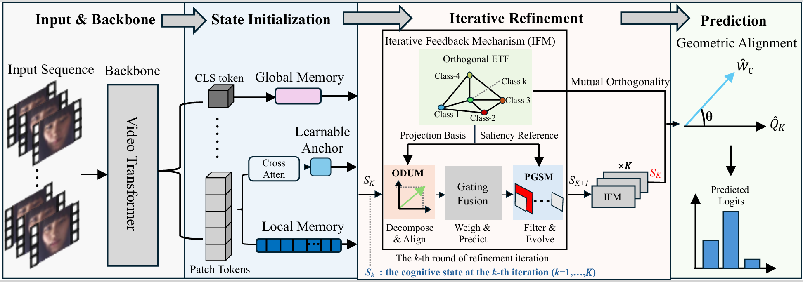

<div align="center">

# IOR-Net: Iterative Orthogonal Refinement Network for Dynamic Facial Expression Recognition

[](https://pytorch.org/)
[](https://developer.nvidia.com/cuda-toolkit)
[](https://www.python.org/)
[](LICENSE)

</div>

Official PyTorch implementation of **IOR-Net** (*Iterative Orthogonal Refinement Network*) for Dynamic Facial Expression Recognition (DFER) in unconstrained scenarios.

## Overview

Dynamic facial expressions in the wild are often transient, low-intensity, and corrupted by pose variations, occlusions, and neutral transition frames. **IOR-Net** formulates video expression recognition as progressive state-space estimation through three coordinated components built atop a Vision Transformer video backbone (`InternVideo2-S/14`):

* **Iterative Feedback Mechanism (IFM):** Establishes a closed-loop recurrent inference trajectory across $K$ steps with momentum-stabilized state evolution ($\beta = 0.9$) to progressively revisit video representations and rectify early misalignments.
* **Orthogonal Decomposition Update Module (ODUM):** Uses learnable class prototypes initialized as a mutually orthogonal Equiangular Tight Frame (O-ETF) to decompose latent hypotheses into prototype-aligned signal and orthogonal residual components, confining refinement to the orthogonal complement to mitigate cross-class interference and feature collapse.
* **Prototype-Guided Saliency Module (PGSM):** Evaluates token-to-prototype alignment ($\epsilon = 0.1$) to emphasize expressive apices while suppressing non-informative neutral tokens and background clutter during feedback memory updates.

<p align="center">
  
</p>
<p align="center">
  <em><strong>Figure 1.</strong> Overview of the Iterative Orthogonal Refinement Network (IOR-Net), operating across four stages: video tokenization, state initialization, $K$-step iterative orthogonal refinement with prototype-guided saliency filtering, and scaled cosine prototype prediction.</em>
</p>

---

## Key Results

All models are trained end-to-end from Kinetics-400 pre-trained `InternVideo2-S/14` ($T=16$, $224 \times 224$) under a unified protocol (50 epochs, batch size 8, AdamW with weight decay $0.05$, cosine schedule with $10\%$ warmup, backbone learning rate $1 \times 10^{-5}$, new-module learning rate $1 \times 10^{-4}$, label smoothing $0.1$). Multi-fold standard deviations follow Bessel-corrected sample std (`ddof=1`).

### Benchmark Performance

| Benchmark | Evaluation Protocol | Config $(K, L)$ | UAR (%) | WAR (%) |
| :--- | :--- | :---: | :---: | :---: |
| **DFEW** | 5-Fold CV (7 basic emotions) | $(5, 1)$ | **$63.72 \pm 1.58$** | **$74.18 \pm 1.51$** |
| **FERV39k** | Official Split (7 basic emotions) | $(6, 1)$ | **$43.09$** | **$53.35$** |
| **MAFW-11** | 5-Fold CV (11 single-labeled) | $(4, 1)$ | **$42.21$** | **$55.70$** |
| **MAFW-43** | 5-Fold CV (43 compound emotions) | $(4, 1)$ | **$14.54$** | **$37.40$** |

### Step-wise Iterative Error Rectification ($y_1 \to y_K$)

Evaluating intermediate predictions from the exact same trained checkpoints demonstrates consistent net positive error rectification from step 1 ($y_1$) to the final step ($y_K$):

| Benchmark | Clips ($N$) | Step-1 WAR (%) | Final WAR (%) | $\Delta$WAR (%) | Corrected / Erroneous | Exact McNemar $p$-value |
| :--- | :---: | :---: | :---: | :---: | :---: | :---: |
| **DFEW** ($K=5$) | 11,697 | 72.79 | **74.18** | $+1.39$ | $+258$ / $-95$ | $1.57 \times 10^{-18}$ |
| **FERV39k** ($K=6$) | 7,847 | 51.34 | **53.35** | $+2.01$ | $+382$ / $-225$ | $1.93 \times 10^{-10}$ |
| **MAFW-11** ($K=4$) | 9,172 | 55.10 | **55.70** | $+0.60$ | $+189$ / $-134$ | $2.60 \times 10^{-3}$ |
| **MAFW-43** ($K=4$) | 8,996 | 36.79 | **37.40** | $+0.61$ | $+236$ / $-181$ | $8.11 \times 10^{-3}$ |

### Qualitative Case Studies of Iterative Refinement

<p align="center">
  
</p>
<p align="center">
  <em><strong>Figure 2.</strong> Qualitative examples illustrating progressive error rectification across iterative refinement steps, where IOR-Net resolves initial feature ambiguities and converges to accurate expression predictions.</em>
</p>

---

## Repository Structure

```text
IOR-Net/
├── checkpoints/                  # Pretrained IOR-Net (.pth) weights
│   ├── dfew/                     # Final_FullTrain_K5_L1_Fold{1..5}.pth
│   ├── ferv39k/                  # Final_SOTA_FERV_K6_L1.pth
│   ├── mafw11/                   # Final_FullTrain_MAFW_K4_L1_Fold{1..5}.pth
│   └── mafw43/                   # Best_SOTA_MAFW43_K4_L1_Fold{1..5}.pth
├── configs/
│   ├── dfew_k5_l1.yaml
│   ├── ferv39k_k6_l1.yaml
│   ├── mafw11_k4_l1.yaml
│   └── mafw43_k4_l1.yaml
├── datasets/
│   ├── __init__.py
│   ├── dfew.py
│   ├── ferv39k.py
│   ├── mafw.py
│   ├── mafw_43.py
│   └── corruptions.py
├── figures/                      # Paper figures rendered in README
├── models/
│   ├── __init__.py
│   ├── ior_net.py
│   └── ior_net_ablation.py
├── scripts/
│   ├── __init__.py
│   ├── train.py
│   ├── arch_search.py
│   ├── train_ablation.py
│   ├── eval_benchmark.py
│   ├── eval_arch_search.py
│   ├── eval_ablation.py
│   ├── eval_multiseed.py
│   ├── eval_cross_dataset.py
│   ├── eval_robustness.py
│   ├── profile_efficiency.py
│   └── visualize_tsne_cm.py
├── pos_embed.py
├── flash_attention_class.py
├── requirements.txt
└── README.md
```

---

## Installation

Experiments were conducted on a single NVIDIA RTX 5090 GPU with Python 3.10+ and PyTorch `2.7.0+cu128`.

1. **Install PyTorch and Torchvision (CUDA 12.8):**

```bash
pip install torch==2.7.0 torchvision==0.22.0 --index-url https://download.pytorch.org/whl/cu128
```

2. **Install Core Dependencies:**

```bash
pip install -r requirements.txt
```

3. **Optional Acceleration (FlashAttention & Fused Kernels):**

IOR-Net automatically falls back to standard PyTorch attention, MLP, and LayerNorm when fused CUDA kernels are unavailable. To enable FlashAttention as used in our hardware profiling:

```bash
pip install flash-attn==2.7.4.post1 --no-build-isolation
```

4. **Upstream Pretrained Backbone & Auxiliary Files:**

* **InternVideo2-S/14 (Kinetics-400):** Download the official Kinetics-400 pre-trained `InternVideo2-S/14` weights from [OpenGVLab/InternVideo](https://github.com/OpenGVLab/InternVideo) and place the file at `./pretrained/internvideo2_s14_k400.bin`.
* **dlib 68-Landmark Predictor (for Spatial Occlusion Robustness):** Download `shape_predictor_68_face_landmarks.dat` from `http://dlib.net/files/shape_predictor_68_face_landmarks.dat.bz2`, decompress it, and place it at `./pretrained/shape_predictor_68_face_landmarks.dat`.

---

## Dataset Preparation & Preprocessing

Due to dataset licensing restrictions, raw video frames are not redistributed in this repository. Please obtain the official benchmarks from their respective providers:

* **DFEW:** [Official Website](https://dfew-dataset.github.io/) (5-fold CV, 7 classes, 11,697 clips)
* **FERV39k:** [Official Website](https://wangyanckxx.github.io/Proj_CVPR2022_FERV39k.html) (Official split, 7 classes, 7,847 test clips)
* **MAFW:** [Official Website](https://mafw-database.github.io/MAFW/) (5-fold CV; 11 single-labeled / 9,172 clips and 43 compound / 8,996 clips)

### Expected Directory Layout

```text
data/
├── DFEW/
│   ├── Clip/clip_224x224_16f/
│   │   ├── 00001/*.jpg
│   │   └── ...
│   └── EmoLabel_DataSplit/
│       ├── train(single-labeled)/set_{1..5}.csv
│       └── test(single-labeled)/set_{1..5}.csv
├── FERV39K/
│   ├── 2_ClipsforFaceCrop/<scene>/<emotion>/<clip_id>/*.jpg
│   └── 4_setups/All_scenes/{train_All.csv,test_All.csv}
└── MAFW/
    ├── data/frames/frames/<clip_id>/{0000.png,...,n_frames}
    └── Train & Test Set/
        ├── single/no_caption/set_{1..5}/{train.txt,test.txt}
        └── compound/no_caption/set_{1..5}/{train.txt,test.txt}
```

### Exact Preprocessing Protocol

1. **Face Crops:** We directly use the official face-cropped frame sequences released by each benchmark (`clip_224x224_16f` for DFEW, `2_ClipsforFaceCrop` for FERV39k, and official extracted face frames for MAFW).
2. **Temporal Sampling ($T=16$):** Clips shorter than 16 frames are temporally loop-padded to 16 frames. Longer clips are divided into 16 uniform segments, sampling a random frame per segment during training and the deterministic segment midpoint during validation/testing.
3. **Spatial Augmentation & Normalization:**
   * **Training:** Clip-consistent random horizontal flip ($p=0.5$) and random resized crop (scale $[0.8, 1.0]$, ratio $[0.75, 1.33]$) resized to $224 \times 224$.
   * **Validation / Testing:** Direct deterministic resize to $224 \times 224$ without cropping.
   * **Normalization:** Channel-wise ImageNet normalization ($\mu = [0.485, 0.456, 0.406]$, $\sigma = [0.229, 0.224, 0.225]$).
4. **Landmark-Guided Occlusion Protocol (`datasets/corruptions.py`):** For `Occ_Background`, `Occ_Eyes`, and `Occ_Mouth`, frame-wise 68-point facial landmarks are localized via `dlib` (clip-level coverage: `87.75%` on DFEW, `97.36%` on FERV39k, and `95.45%` on MAFW-11), with nearest-valid-frame temporal interpolation and canonical-crop fallback when a face is undetected.

---

## Pretrained Checkpoints

Pretrained IOR-Net weights (Seed 42) are organized under `./checkpoints/` (and mirrored via [GitHub Releases](https://github.com/Kz801/IOR-Net/releases)):

| Benchmark | Config $(K, L)$ | Splits | Checkpoint Path | UAR (%) | WAR (%) |
| :--- | :---: | :---: | :--- | :---: | :---: |
| **DFEW** | $(5, 1)$ | Fold 1–5 | `checkpoints/dfew/Final_FullTrain_K5_L1_Fold{1..5}.pth` | $63.72 \pm 1.58$ | $74.18 \pm 1.51$ |
| **FERV39k** | $(6, 1)$ | Official | `checkpoints/ferv39k/Final_SOTA_FERV_K6_L1.pth` | $43.09$ | $53.35$ |
| **MAFW-11** | $(4, 1)$ | Fold 1–5 | `checkpoints/mafw11/Final_FullTrain_MAFW_K4_L1_Fold{1..5}.pth` | $42.21$ | $55.70$ |
| **MAFW-43** | $(4, 1)$ | Fold 1–5 | `checkpoints/mafw43/Best_SOTA_MAFW43_K4_L1_Fold{1..5}.pth` | $14.54$ | $37.40$ |

> Architecture search checkpoints, ablation variants, and additional multi-seed models (Seeds 100 and 2026) can be reproduced directly using the training scripts below.

---

## Training

### 1. Full Training with Benchmark Configs

```bash
# DFEW (5-fold, K=5, L=1)
python scripts/train.py --config configs/dfew_k5_l1.yaml

# FERV39k (Official split, K=6, L=1)
python scripts/train.py --config configs/ferv39k_k6_l1.yaml

# MAFW-11 (5-fold, K=4, L=1)
python scripts/train.py --config configs/mafw11_k4_l1.yaml

# MAFW-43 (5-fold, K=4, L=1)
python scripts/train.py --config configs/mafw43_k4_l1.yaml
```

Any parameter can be overridden via CLI (for example, `--seed 100` or `--seed 2026` for multi-seed stability runs).

### 2. Two-Stage Greedy Architecture Search & Iso-FLOPs Tiers

```bash
python scripts/arch_search.py \
  --dataset dfew \
  --data_root ./data/DFEW/Clip/clip_224x224_16f \
  --split_dir ./data/DFEW/EmoLabel_DataSplit \
  --pretrained_path ./pretrained/internvideo2_s14_k400.bin \
  --inner_val_ratio 0.10 \
  --patience 2 \
  --run_iso_tiers \
  --run_full_refit \
  --output_dir ./outputs/arch_search_dfew
```

### 3. Component & Micro-Ablation Suite

```bash
python scripts/train_ablation.py \
  --dataset dfew \
  --data_root ./data/DFEW/Clip/clip_224x224_16f \
  --split_dir ./data/DFEW/EmoLabel_DataSplit \
  --pretrained_path ./pretrained/internvideo2_s14_k400.bin \
  --epochs 50 \
  --profile_efficiency \
  --output_dir ./outputs/ablation_dfew
```

---

## Evaluation & Reproduction

### 1. Main Benchmarks, Step-wise Dynamics, Orthogonality & O-ETF Geometry

```bash
python scripts/eval_benchmark.py \
  --dataset dfew \
  --data_root ./data/DFEW/Clip/clip_224x224_16f \
  --split_dir ./data/DFEW/EmoLabel_DataSplit \
  --ior_ckpt_dir ./checkpoints/dfew \
  --ior_ckpt_pattern "Final_FullTrain_K5_L1_Fold{fold}.pth" \
  --save_fig7 \
  --output_dir ./outputs/eval_dfew
```

Set `--dataset` to `ferv39k`, `mafw11`, or `mafw43` with the corresponding paths and checkpoint patterns to evaluate all four benchmarks.

### 2. Zero-Shot Cross-Dataset Generalization (All 6 Directions)

```bash
python scripts/eval_cross_dataset.py \
  --dfew_data_root ./data/DFEW/Clip/clip_224x224_16f \
  --dfew_split_dir ./data/DFEW/EmoLabel_DataSplit \
  --ferv_data_root ./data/FERV39K/2_ClipsforFaceCrop \
  --ferv_split_dir ./data/FERV39K/4_setups/All_scenes \
  --mafw_data_root ./data/MAFW/data/frames/frames \
  --mafw_split_dir "./data/MAFW/Train & Test Set/single/no_caption" \
  --dfew_ior_dir ./checkpoints/dfew \
  --ferv_ior_ckpt ./checkpoints/ferv39k/Final_SOTA_FERV_K6_L1.pth \
  --mafw_ior_dir ./checkpoints/mafw11 \
  --output_dir ./outputs/eval_cross_dataset
```

### 3. Unified 12-Condition Spatial & Temporal Corruption Robustness

```bash
python scripts/eval_robustness.py \
  --dataset dfew \
  --data_root ./data/DFEW/Clip/clip_224x224_16f \
  --split_dir ./data/DFEW/EmoLabel_DataSplit \
  --ior_ckpt_dir ./checkpoints/dfew \
  --ior_ckpt_pattern "Final_FullTrain_K5_L1_Fold{fold}.pth" \
  --dlib_predictor ./pretrained/shape_predictor_68_face_landmarks.dat \
  --conditions all \
  --output_dir ./outputs/eval_robustness_dfew
```

### 4. Multi-Seed Stability, Ablations & Efficiency Profiling

```bash
# Multi-seed stability (Seeds 42, 100, 2026)
python scripts/eval_multiseed.py \
  --dataset dfew \
  --data_root ./data/DFEW/Clip/clip_224x224_16f \
  --split_dir ./data/DFEW/EmoLabel_DataSplit \
  --ior_ckpt_dir ./checkpoints/multiseed_dfew \
  --seed42_ior_dir ./checkpoints/dfew \
  --seed42_ior_pattern "Final_FullTrain_K5_L1_Fold{fold}.pth"

# Ablation evaluation
python scripts/eval_ablation.py \
  --dataset dfew \
  --data_root ./data/DFEW/Clip/clip_224x224_16f \
  --split_dir ./data/DFEW/EmoLabel_DataSplit \
  --abl_ckpt_dir ./outputs/ablation_dfew \
  --full_ckpt_dir ./checkpoints/dfew \
  --full_ckpt_pattern "Final_FullTrain_K5_L1_Fold{fold}.pth"

# FP16 hardware efficiency & Iso-FLOPs profiling
python scripts/profile_efficiency.py --suite all --batch_size 8
```

---

## Acknowledgments

This codebase builds upon the Vision Transformer video backbone from [OpenGVLab/InternVideo](https://github.com/OpenGVLab/InternVideo). We thank the authors of InternVideo2, DFEW, FERV39k, and MAFW for releasing their models and benchmarks to the research community.
